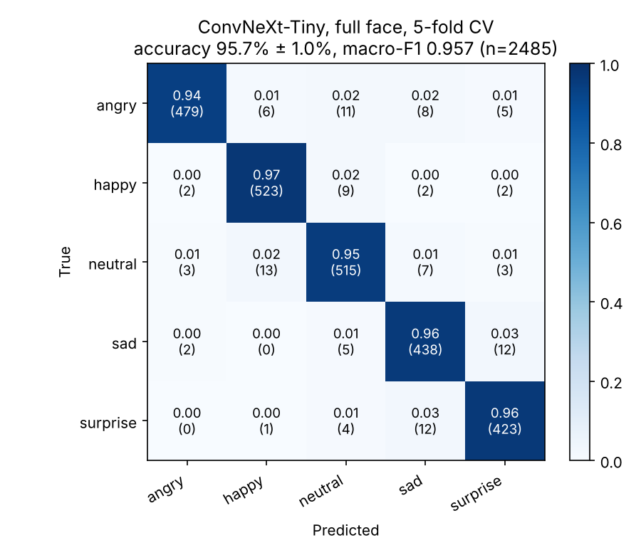

# Thermal Facial Emotion Recognition (Comprehensive Facial Thermal Dataset)

Five-class emotion recognition (anger, happiness, neutral, sadness, surprise) from low-cost false-colour thermal face images, using fine-tuned ImageNet CNNs, evaluated under three protocols.

Code and paper for *"Whole-Face Thermal Emotion Recognition on a Low-Cost, Multi-Palette Dataset: Deep Models, Evaluation Protocols and Session Confounds"* (AKGEC, 2026). The draft paper is in [`paper/`](paper/).

## Results

| Protocol | Network | Accuracy | Macro F1 |
|---|---|---|---|
| P1 image-level 5-fold CV | **ConvNeXt-Tiny** | **95.7 ± 1.0 %** | 0.957 |
| P1 image-level 5-fold CV | EfficientNet-B0 | 88.6 ± 1.1 % | 0.885 |
| P2 recording bursts held out (5-fold) | EfficientNet-B0 | 15.8 ± 5.0 % | 0.127 |
| P3 unseen session (train on 2023, test on 2024-03-03) | EfficientNet-B0 | 34.9 % | 0.323 |
| P3 unseen session (train on 2023, test on 2024-03-03) | ConvNeXt-Tiny | **36.3 %** | 0.339 |

Chance is 20 %. Per-fold numbers are in [`results/results_summary.csv`](results/results_summary.csv).



### How to read these numbers

- **The camera writes the date, time, spot temperature and a colour bar into every image.** The script crops these out (`--crop 0 0.15 0.2 0`). Without the crop, a model could read the printed date.
- **The emotions were recorded in different sessions.** The file names (`imgYYYYMMDD_HHMMSS`) show five recording dates. Most dates contain only one or two emotions, and only 2024-03-03 contains all five.
- **P1 is inflated.** P1 (a random image split, as commonly reported) puts frames from the same recording burst into both the training and test sets, so its accuracy mostly measures recognition of the recording context.
- **P3 is the realistic estimate.** It tests on a session the model has never seen. Report P3 next to any P1 number.

## Setup

```bash
pip install -r requirements.txt
```

A GPU is strongly recommended. Google Colab with a T4 GPU takes about 5.5 minutes per ConvNeXt-Tiny fold.

## Data

The data is the Comprehensive Facial Thermal Dataset by Abuhussein, Darwish and Hassanien (2024), Mendeley Data, doi:10.17632/8885sc9p4z.1. It is licensed CC BY 4.0 and is not included in this repo.

```bash
curl -L -o data.zip https://data.mendeley.com/public-api/zip/8885sc9p4z/download/1
unzip -q data.zip -d raw
cd "raw/Comprehensive Facial Thermal Dataset/Facial Emotion" && unrar x "Facial emotion.rar" && cd -
D="raw/Comprehensive Facial Thermal Dataset/Facial Emotion/Facial emotion"
```

The script reads emotion and palette labels from the folder names. It handles the archive's misspelt folders (`surpise`, `IRNBOW`, `natural`).

## Reproducing the paper

```bash
C="--crop 0 0.15 0.2 0 --workers 2 --epochs 25"

# Check counts and overlays (writes samples_per_palette.png)
python thermal_emotion_train.py --data "$D" --scan-only --crop 0 0.15 0.2 0

# P1: image-level 5-fold, best model, also trains and saves final_model.pt
python thermal_emotion_train.py --data "$D" $C --group-by dup --archs convnext_tiny --save-final --out runF_convnext
python thermal_emotion_train.py --data "$D" $C --group-by dup --archs efficientnet_b0 --out runD_effb0

# P2: whole recording bursts held out
python thermal_emotion_train.py --data "$D" $C --group-by time --archs efficientnet_b0 --out runA_bursts

# P3: train on 2023 sessions, test on the unseen 2024-03-03 session
python thermal_emotion_train.py --data "$D" $C --group-by time --holdout-regex img20240303 --archs convnext_tiny --out runB_convnext
python thermal_emotion_train.py --data "$D" $C --group-by time --holdout-regex img20240303 --archs efficientnet_b0 --out runB_effb0
```

Each run writes per-fold metrics, a confusion matrix, per-palette accuracy and all predictions to its `--out` folder.

Other options are listed under `python thermal_emotion_train.py --help`. They include:
- training one model per palette (`--palette-mode per-palette`) or converting to grayscale (`gray`)
- ensembles (`--archs efficientnet_b0 convnext_tiny`)
- mixup/cutmix
- person-independent splits from a subject CSV (`--subjects`)

## Using the trained model

```python
from thermal_emotion_train import predict_image
print(predict_image("runF_convnext/final_model.pt", "face.bmp"))
# {'happy': 0.97, 'neutral': 0.02, ...}
```

The trained `final_model.pt` is 111 MB, which is larger than GitHub's file limit, so it is not stored in this repo.

## Training details

- **Networks:** ImageNet-pretrained ConvNeXt-Tiny or EfficientNet-B0 from torchvision, fine-tuned end to end.
- **Optimiser:** AdamW, learning rate 1e-4 for the pretrained layers and 1e-3 for the new classifier head, weight decay 1e-4. One warm-up epoch, then cosine decay.
- **Loss and schedule:** label smoothing 0.1, batch size 32, at most 25 epochs, early stopping after 8 epochs without improvement in validation macro F1.
- **Augmentation:** random resized crop to 224, horizontal flip, ±10° rotation, ±15 % brightness and contrast, random erasing. Hue is never changed, because colour encodes temperature.
- **Test-time augmentation:** predictions on the image and its horizontal flip are averaged.
- **Model selection:** uses an inner validation split taken from the training groups only; the test fold is never used.
